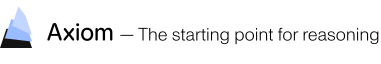

[](https://axiommath.ai/)

# Log-Concavity in Narayana Transforms and Stack-Sorting Fibers

This is a Lean formalization of log-concavity and real-rootedness for stack-sorting fibers and
Narayana transforms.

## Main Results

* For every permutation `π ∈ S_n`, the fiber descent polynomial `D_π(x)` is ultra-log-concave of
  order `n - 1`, and hence log-concave (Theorem 1.1), assuming two results of Brändén–Huh.
* For every `π` in the image of the stack-sorting map, the top polynomial of its fiber is the basis
  generating polynomial of a laminar matroid of rank `n - 1`, and hence Lorentzian (Theorem 1.2),
  assuming Brändén–Huh's Theorem 3.10.
* For every `λ ∈ [0, 2]`, the peak-weighted fiber polynomial `H^λ_π(x, y)` is Lorentzian
  (Theorem 1.3), assuming results of Brändén–Huh.
* The Narayana transform of a homogeneous real-stable polynomial with nonnegative
  coefficients has only real zeros, all negative (Theorem 1.4), assuming Borcea–Brändén's
  Theorem 1.2 and Liu–Wang's Proposition 3.2.
* For every integral binary nestohedron `P` and every `λ ∈ [0, 2]`, the sum over the lattice
  points of `P` of products of deformed Narayana polynomials is log-concave with no internal zeros
  (Corollary 4.7), assuming results of Brändén–Huh and Defant.
* For every `λ ≥ 0`, the deformed Narayana transform of such a polynomial is real-rooted
  (Corollary 6.3), assuming Borcea–Brändén's Theorem 1.2 and Liu–Wang's Proposition 3.2.
* The restricted noncrossing refinement polynomials `R^{(a),λ}_{n,k}(x)` are log-concave with no
  internal zeros for every `λ ∈ [0, 2]` (Theorem 7.1), assuming results of Brändén–Huh, Defant and
  Kreweras.
* There is an integral polytope in `ℝ^27`, with positive coordinates summing to `51`, whose
  Narayana sum is not log-concave (Proposition 9.5); it is not a generalized permutohedron.

Every numbered theorem, proposition, corollary and lemma of the paper is formalized, together with
further claims of its text, labelled by their location; in the namespace `LogNarayana.Challenge`
they are:

| Paper | Lean |
| --- | --- |
| Theorem 1.1 | `List.isUltraLogConcave_fiberDescentPolynomial`, `List.isLogConcave_fiberDescentPolynomial` |
| Theorem 1.2 | `List.exists_isLaminar_basisGeneratingPolynomial_eq_fiberTopPolynomial`, `List.isLorentzian_fiberTopPolynomial` |
| eq. (1.4) | `isUltraLogConcave_finsum_prod_narayanaPolynomial` |
| Theorem 1.3 | `List.isLorentzian_fiberPeakPolynomial` |
| Theorem 1.4 | `MvPolynomial.IsHomogeneous.hasOnlyNegativeRoots_narayanaTransform`, `MvPolynomial.splits_narayanaTransform_of_isRealStable` |
| Proposition 3.1 | `List.fiberDescentPolynomial_eq_finsum_fiberMatchings`, `List.eval_fiberDescentPolynomial_eq_pow_mul_eval_fiberMatchingPolynomial`, `BinaryTree.bijOn_treeMatching_treeRightChoices` |
| Lemma 3.2 | `List.isPostorderForest_adoptableForest`, `List.isAdoptablePair_iff_isStrictAncestor`, `List.isLeaf_adoptableForest_of_mem_descentSet` |
| Theorem 3.4 | `Matroid.encard_eq_of_isBase_of_indep_iff_mem_forestIndepFamily`, `forestMatchingPoly_eq_sum_isBase_prod_X`, `isLorentzian_forestMatchingPoly`, `coeff_forestMatchingPoly_eq_zero_or_eq_one` |
| Corollary 3.6 | `List.isUltraLogConcave_conditionalTopPolynomial` |
| Proposition 3.7 | `Matroid.isLorentzian_sum_indep_mul_X_pow_div_factorial` |
| Theorem 4.1 | `MvPolynomial.IsLorentzian.simplexIntegral`, `MvPolynomial.IsHomogeneous.simplexIntegral` |
| Corollary 4.2 | `MvPolynomial.IsLorentzian.tConvolution`, `MvPolynomial.IsLorentzian.antiderivative` |
| Lemma 4.3 | `MvPolynomial.isLorentzian_quadraticKernel_iff`, `MvPolynomial.isLorentzian_rootOperator` |
| Theorem 4.4 | `isLorentzian_factorialNormalization_weightedOpenPairPolynomial`, `isLorentzian_sum_admissibleMatching_pow_mul_pow` |
| Theorem 4.6 | `MvPolynomial.isLorentzian_pow_mul_finsum_latticePoints_prod_narayanaQ`, `MvPolynomial.isHomogeneous_pow_mul_finsum_latticePoints_prod_narayanaQ`, `MvPolynomial.isLorentzian_finsum_latticePoints_prod_mul_narayanaQ` |
| Corollary 4.7 | `Polynomial.isLogConcave_finsum_latticePoints_prod_deformedNarayanaPolynomial`, `Polynomial.hasNoInternalZeros_coeff_finsum_latticePoints_prod_deformedNarayanaPolynomial` |
| Example after Corollary 4.7 | `MvPolynomial.isLorentzian_esymm_two_pow_mul_finsum_latticePoints_prod_narayanaQ` |
| Proposition 4.8 | `MvPolynomial.isLorentzian_higherKernelOperator`, `MvPolynomial.IsHomogeneous.higherKernelOperator`, `MvPolynomial.higherKernelOperator_eq_sum_kernelCoeff` |
| Section 4.4 | `MvPolynomial.isRealStable_elementaryKernel`, `MvPolynomial.isLorentzian_elementaryKernel` |
| Theorem 5.1 | `List.isUltraLogConcave_familyFiberDescentPolynomial_localColorFamily`, `List.isLogConcave_familyFiberDescentPolynomial_localColorFamily` |
| Proposition 5.2 | `List.schroederFiberPolynomial_eq`, `List.isLorentzian_schroederFiberPolynomial`, `List.isUltraLogConcave_schroederFiberPolynomial_eval_one` |
| End of Section 5 | `Polynomial.isLogConcave_finsum_latticePoints_prod_schroederFactor` |
| Lemma 6.1 | `Polynomial.degree_signedAppell_sub_X_pow_lt`, `Polynomial.encard_setOf_eval_signedAppell_eq_zero`, `Polynomial.derivative_signedAppell`, `Polynomial.aeval_add_signedAppell` |
| Proposition 6.2 | `MvPolynomial.isRealStable_appellOperator` |
| Corollary 6.3 | `MvPolynomial.IsHomogeneous.splits_deformedNarayanaTransform` |
| Section 6.2 | `LooplessMultigraph.splits_orientationSum`, `LooplessMultigraph.splits_weightedOrientationSum` |
| Lemma 6.4 | `LooplessMultigraph.IsForest.bijOn_add_indegree_orientations_latticePoints_zonotope` |
| Theorem 6.5 | `LooplessMultigraph.IsForest.hasOnlyNegativeRoots_finsum_latticePoints_zonotope`, `LooplessMultigraph.IsForest.splits_finsum_latticePoints_zonotope` |
| Corollary 6.7 | `List.splits_fiberDescentPolynomial_of_isRealStable_validCompositionPoly` |
| Theorem 7.1 | `Polynomial.isLogConcave_restrictedNoncrossingDeformedNarayanaPoly`, `Polynomial.hasNoInternalZeros_coeff_restrictedNoncrossingDeformedNarayanaPoly`, `Polynomial.isLogConcave_restrictedNoncrossingRefinementPoly`, `Polynomial.hasNoInternalZeros_coeff_restrictedNoncrossingRefinementPoly` |
| Proposition 7.3 | `Polynomial.splits_restrictedNoncrossingRefinementPoly_two` |
| Corollary 7.4 | `PartitionAtMostParts.isLogConcave_schurNarayanaTransform_hook`, `PartitionAtMostParts.isLogConcave_schurNarayanaTransform_two` |
| After Corollary 7.4 | `PartitionAtMostParts.hasOnlyNegativeRoots_schurNarayanaTransform_row`, `PartitionAtMostParts.splits_schurNarayanaTransform_hook_one` |
| Proposition 8.1 | `Matroid.isLorentzian_narayanaPolynomial`, `Matroid.isHomogeneous_narayanaPolynomial`, `Matroid.isUltraLogConcave_aeval_narayanaPolynomial`, `Matroid.splits_aeval_narayanaPolynomial` |
| Proposition 9.5 | `exists_isIntegralPolytope_not_isLogConcave_finsum_latticePoints_prod_narayanaPolynomial` |
| Remark after Proposition 9.5 | `not_isGeneralizedPermutohedron_nlcPolytope` |

See [§Formal Challenge](#formal-challenge) for a formal certificate.

## Cited Results

The formalization assumes the following results from the literature. Each is stated as a `Prop`
and taken as a hypothesis by the theorems that use it; the last column lists the results of the
table above whose statements assume it (a dash: only results of the library outside that table).

| Lean `Prop` | Source | Used by |
| --- | --- | --- |
| `BonaFiberDescentSymmetric` | Bóna, *Symmetry and unimodality in t-stack sortable permutations* (2002), main theorem (symmetry) | — |
| `BonaFiberDescentUnimodal` | Bóna, *Symmetry and unimodality in t-stack sortable permutations* (2002), main theorem (unimodality) | — |
| `BrandenFiberDescentGammaNonneg` | Brändén, *Actions on permutations and unimodality of descent polynomials* (2008), Corollary 3.2; Defant, *Counting 3-stack-sortable permutations* (2020), Theorem 1.3 | — |
| `ShiftedNarayanaNegRealRoots` | Liu–Wang, *A unified approach to polynomial sequences with only real zeros* (2007), Proposition 3.2 | Thm 1.4, Lem 6.1, Prop 6.2, Cor 6.3, Sec 6.2, Thm 6.5, Cor 6.7, Prop 8.1 |
| `ShiftedNarayanaInterlacing` | Liu–Wang, *A unified approach to polynomial sequences with only real zeros* (2007), Proposition 3.2 | Prop 8.1 |
| `RefinedFertilityFormula` | Defant, *Fertilitopes* (2023), Corollary 2.4 | eq. (1.4), Thm 4.6, Cor 4.7, Ex. after Cor 4.7, Cor 6.7, Thm 7.1, Cor 7.4 |
| `IntegralBinaryNestohedronRealization` | Defant, *Fertilitopes* (2023), Theorems 3.1 and 3.2 | eq. (1.4), Thm 4.6, Cor 4.7, Ex. after Cor 4.7, End of Sec 5, Thm 7.1, Cor 7.4 |
| `MvPolynomial.LorentzianNonnegLinearSubstitution` | Brändén–Huh, *Lorentzian polynomials* (2020), Theorem 2.10 | Thm 1.1, eq. (1.4), Thm 1.3, Cor 3.6, Prop 3.7, Thm 4.1, Cor 4.2, Lem 4.3, Thm 4.4, Thm 4.6, Cor 4.7, Ex. after Cor 4.7, Prop 4.8, Thm 5.1, Prop 5.2, End of Sec 5, Thm 7.1, Cor 7.4 |
| `MvPolynomial.LorentzianNonnegDerivative` | Brändén–Huh, *Lorentzian polynomials* (2020), Corollary 2.11 | Thm 1.3, Cor 3.6, Lem 4.3, Thm 4.4, Thm 4.6, Cor 4.7, Ex. after Cor 4.7, Prop 4.8, Thm 5.1, Thm 7.1, Cor 7.4 |
| `MvPolynomial.LorentzianMul` | Brändén–Huh, *Lorentzian polynomials* (2020), Theorem 2.30 and Corollary 2.32 | Thm 1.3, Thm 4.1, Cor 4.2, Lem 4.3, Thm 4.4, Thm 4.6, Cor 4.7, Ex. after Cor 4.7, Prop 4.8, Thm 5.1, Prop 5.2, End of Sec 5, Thm 7.1, Cor 7.4 |
| `MvPolynomial.IsLorentzianClosed` | Brändén–Huh, *Lorentzian polynomials* (2020), Theorem 2.25 | Prop 3.7 |
| `MvPolynomial.BrandenHuhSymbolTheorem` | Brändén–Huh, *Lorentzian polynomials* (2020), Theorem 3.2 | Thm 1.3, Thm 4.1, Cor 4.2, Lem 4.3, Thm 4.4, Thm 4.6, Cor 4.7, Ex. after Cor 4.7, Prop 4.8, Thm 5.1, Thm 7.1, Cor 7.4, Prop 8.1 |
| `MvPolynomial.NormalizedSupportPolyLorentzianOfMConvex` | Brändén–Huh, *Lorentzian polynomials* (2020), Theorem 3.10 | Thm 1.1, Thm 1.2, eq. (1.4), Thm 1.3, Thm 3.4, Cor 3.6, Prop 3.7, Thm 4.1, Cor 4.2, Lem 4.3, Thm 4.4, Thm 4.6, Cor 4.7, Ex. after Cor 4.7, Prop 4.8, Thm 5.1, Prop 5.2, End of Sec 5, Thm 7.1, Cor 7.4, Prop 8.1 |
| `IsRealStablePDerivClosed` | Wagner, *Multivariate stable polynomials: theory and applications* (2011), Lemma 2.4(f) | Sec 4.4, Prop 7.3, After Cor 7.4 |
| `IsRealStableSpecializeClosed` | Wagner, *Multivariate stable polynomials: theory and applications* (2011), Lemma 2.4(d) | Sec 4.4, Prop 7.3, After Cor 7.4 |
| `IsRealStableLimitClosed` | Hurwitz's theorem; Borcea–Brändén, *The Lee–Yang and Pólya–Schur programs. I* (2009), Theorem 1.6 | Sec 4.4 |
| `RealStablePreserverOfSymbol` | Borcea–Brändén, *The Lee–Yang and Pólya–Schur programs. I* (2009), Theorem 1.2 | Thm 1.4, Prop 6.2, Cor 6.3, Sec 6.2, Thm 6.5, Cor 6.7, Prop 8.1 |
| `IsLorentzianOfRealStable` | Brändén–Huh, *Lorentzian polynomials* (2020), Proposition 2.2 | Sec 4.4, Prop 8.1 |
| `IsRealStableHomogenizeOfNonneg` | Borcea–Brändén–Liggett, *Negative dependence and the geometry of polynomials* (2009), Theorem 4.5 | Prop 8.1 |
| `SchroederTreesBlackGenFunEq` | Defant, *Troupes, cumulants, and stack-sorting* (2022), Example 4.12 | End of Sec 5 |
| `SchroederRefinedFertilityFormula` | Defant, *Troupes, cumulants, and stack-sorting* (2022), Theorem 4.5 | End of Sec 5 |
| `Finpartition.KrewerasBlockSizeCount` | Kreweras, *Sur les partitions non croisées d'un cycle* (1972), Theorem 4 | Thm 7.1, Prop 7.3, After Cor 7.4 |
| `Polynomial.JacobiRootsSimpleInIoo` | NIST DLMF, §18.2(vi) and Table 18.3.1 (zeros of Jacobi polynomials) | After Cor 7.4 |
| `Polynomial.GammaRealRootedIff` | Brändén; Gal; as stated in Ferroni–Panova–Venturello, Theorem 1.1 | — |
| `Polynomial.NewtonInequalities` | Newton's inequalities; Stanley, *Log-concave and unimodal sequences in algebra, combinatorics, and geometry* (1989), Theorem 2 | — |

The library also states, as `Prop`s that no theorem assumes, the further results the paper cites
from Chen–Wang–Yang (`ShiftedNarayanaCoeffLogConvex`, `NarayanaTransformLogConvex`), Defant
(`HookCompositionInjOn`, `FertilitopeLatticePointsEq`, `FertilitopeIsIntegralBinaryNestohedron`),
Brändén–Huh (`MvPolynomial.LorentzianLogConcave`, `MvPolynomial.FullFactorialNormalizationMulLorentzian`),
Edelman (`Finpartition.EdelmanChainCount`) and Huh–Matherne–Mészáros–St. Dizier
(`PartitionAtMostParts.NormalizedSchurIsLorentzian`).

## Dependencies

This depends on [Mathlib](https://github.com/leanprover-community/mathlib4).

## Formal Challenge

A formal challenge file certifying that this repository does formalize the results
claimed above is located at [Challenge/Basic.lean](Challenge/Basic.lean). This file only
depends on the dependency above. It contains formal statements of
[§Main Results](#main-results) with `sorry` as proof.

This repository can be verified against the formal challenge with the Lean
comparator on a Linux machine. First, follow the instructions in
https://github.com/leanprover/comparator to install `comparator`. Then, run the following command:

```
lake env comparator Comparator/comparator.json
```

This repository has been verified with the comparator (Lean kernel only).
